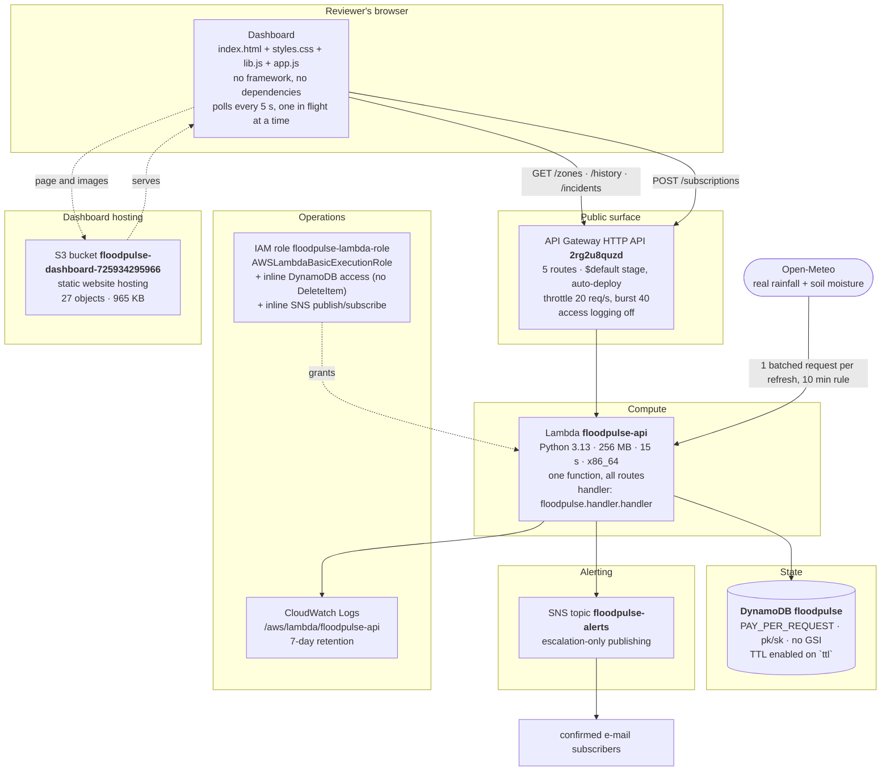

# FloodPulse architecture

Current as of **2026-10-24** (M18 closeout). Everything in the tables was read from the deployed
resources with read-only CLI calls in this pass; nothing here is aspirational.

---

## 1. Request path in one picture

Two writers reach the data store: the **live weather pipeline** inside the Lambda (every read of
`/zones` refreshes the weather when the cache is older than 10 minutes and stores a sample) and the
**simulator**, either in-process for the demo fleet or over `POST /readings` with the ingestion key.

## 2. Components, as deployed

| Component | Identity | Configuration (measured) |
|---|---|---|
| Function | `floodpulse-api` | python3.13, 256 MB, timeout 15 s, x86_64, Active, package 106,673 B, last modified 2026-10-22T07:11:39Z |
| API | `2rg2u8quzd` | HTTP API, 5 routes, every route `AuthType NONE` (authorisation is in the handler), `$default` stage with auto-deploy, 20 req/s + 40 burst, detailed metrics off, access logging off |
| Table | `floodpulse` | `PAY_PER_REQUEST`, keys `pk`/`sk`, **no GSI**, TTL enabled on `ttl`, 1,772 items / 1,492,158 B |
| Bucket | `floodpulse-dashboard-725934295966` | static website hosting, index and error document `index.html`, 27 objects / 965,225 B |
| Topic | `floodpulse-alerts` | 1 confirmed e-mail subscription; publish only when a city **escalates** |
| Logs | `/aws/lambda/floodpulse-api` | 7-day retention, 4,013,428 B stored |
| Role | `floodpulse-lambda-role` | managed `AWSLambdaBasicExecutionRole`; inline `FloodPulseDynamoDBAccess` (`GetItem`, `PutItem`, `UpdateItem`, `Query` on the one table - **no `DeleteItem`**); inline `FloodPulseSnsPublish` (`sns:Publish`, `sns:Subscribe` on the one topic) |
| Region / account | `eu-north-1` / `725934295966` | profile `cloud-project` |

No EC2, RDS, ECS/EKS, OpenSearch, CloudFront, VPC, NAT gateway or provisioned DynamoDB capacity exists
for this project. API Gateway access logging is **not** enabled - see
[§6](#6-observability-and-what-is-not-enabled).

## 3. Routes

| Route | Method | Auth | Notes |
|---|---|---|---|
| `/zones` | GET | public | the whole fleet in one response; refreshes the weather cache when stale |
| `/zones/{zone_id}/history` | GET | public | `minutes` 1..1440, default 60; downsamples to at most 600 points; refuses out-of-range with a described error |
| `/incidents` | GET | public | incident list with severity, window and status |
| `/readings` | POST | `x-fp-key` header | the ingestion path; anonymous calls get `401 missing required header 'x-fp-key'` |
| `/subscriptions` | POST | public | validated address, 3 per hour per address, generic anti-enumeration reply |

Wrong method on a known route returns `405` with the allowed list; an unknown path returns API Gateway's
own `{"message":"Not Found"}` before the handler sees it. Unknown zone ids on `/history` return the
handler's `404 {"error":"unknown_zone", ...}`.

## 4. Data model

One table, one fixed partition per city. No read path scans; every read is a `Query` on a known key.

| Item | `pk` | `sk` | Purpose | Lifetime |
|---|---|---|---|---|
| Latest reading | `ZONE#<zone_id>` | `LATEST` | what `/zones` serves as current state | kept |
| History sample | `ZONE#<zone_id>` | `H#<timestamp>[#<n>]` | what `/history` graphs and what the temporal layer analyses | TTL 7 days |
| Weather cache | `ZONE#<zone_id>` | `WEATHER#CACHE` | the provider response and when it was fetched; enforces the 10-minute refresh rule | refreshed in place |
| Incident | `ZONE#<zone_id>` | `INCIDENT#<...>` | the incident record (severity, window, status, band path) | kept |
| Open-incident pointer | `ZONE#<zone_id>` | `INCIDENT-OPEN` | the atomic "one open incident per city" guard | current |
| Alert cooldown marker | `ZONE#<zone_id>` | `ALERT#COOLDOWN` | suppresses repeat publishing for the cooldown window | TTL |
| Subscription budget | `SUB#...` | `SUBRATE#...` / `SUBSRC#...` / `WINDOW#...` | per-address and per-source rate limiting; stores a **hash**, never the address | TTL (window + 1 h) |

The pointer item is why two concurrent readings cannot both open an incident: the write is an atomic
conditional update on a single item, so one wins and the other is told the stored state.

## 5. Front end

Four files, **409,501 bytes** against the unchanged 409,600-byte ceiling (99 bytes of headroom), zero
dependencies, zero external requests except the API itself and its own images.

* `index.html` - the six views and their static structure (Overview, Cities, City, Alerts, Data, About);
* `styles.css` - the design system: colour tokens, bands, layout, responsive rules;
* `lib.js` - pure helpers: formatting, band maths, escaping, the image map, the icons;
* `app.js` - the poller, the renderers, the router, retry/backoff, and the panel states.

Frozen front-end rules that the checks enforce: no inline script (CSP-safe), all payload text escaped, city
images resolved only through an explicit trusted map, one in-flight request at a time, backoff instead of
hammering, and a refused history response that keeps the last good data while stating the reason.

## 6. Observability, and what is not enabled

Enabled: Lambda logs with 7-day retention, structured one-line log events with a request outcome, and the
application-level health information the dashboard itself renders (mode, freshness, per-metric
provenance).

Not enabled, deliberately: **API Gateway access logging**, detailed API metrics, CloudWatch alarms and
X-Ray tracing. Each would either add a resource or widen IAM, and this pass was frozen to documentation
and verification. The honest consequence: **API Gateway access logging is not enabled; Lambda/CloudWatch
application logs provide the current operational trail.**

## 7. Security posture

* Ingestion is key-gated; the key lives in the gitignored `.floodpulse-key` and in the deployed Lambda's
  environment, is never printed, never logged and never committed (verified by digest comparison over all
  112 tracked files in this pass - no match).
* IAM is one role, one table, one topic, no `DeleteItem`, no wildcard resource.
* Every externally supplied payload is validated before use; bodies are capped at 4,096 bytes; unknown
  fields are ignored rather than trusted.
* Public writes are rate-limited per address, with a hashed identifier and a generic response.
* The page ships a content-security policy with no inline script and no wildcard origin, escapes all
  payload text, and renders images only from its own map of local files.
* **Known limitation:** the dashboard is served from an S3 website endpoint, so the CSP travels as a meta
  element. `frame-ancestors` cannot be enforced from a meta element, so clickjacking protection is not
  claimed; a CloudFront distribution with response-header policies would be the fix, and it is a new
  resource the project deliberately did not create.

## 8. Failure behaviour

| Failure | Behaviour |
|---|---|
| Provider unreachable / unusable | serve the last good cached weather, say so in the payload and on the page; the poll still succeeds |
| One city's cache corrupt / foreign / future-dated | that city degrades alone, the other eleven serve normally |
| A history read fails | the panel keeps the last good series and states the reason; retries back off |
| A non-object element in a payload | ignored, so one malformed zone cannot blank the fleet |
| A late history response for a city the visitor left | discarded, so it cannot repaint the wrong city |
| A refused incident write | report stored state, skip the alert, let the next reading re-decide |
| Provider throttling / abusive client | 20 req/s with a 40 burst at the stage, plus the per-address subscription budget |

## 9. Cost model

Billing is per use, and nothing is always-on: static S3 hosting, request-based Lambda, `PAY_PER_REQUEST`
DynamoDB, per-publish SNS, 7-day logs. No NAT gateway, no CloudFront, no provisioned capacity, no
database instance. No dollar figure is claimed anywhere in this repository, because no billing data were
queried; the claims here are about the billing model, not a measured spend.

## 10. Deployment and reproducibility

`infra/deploy.ps1` is idempotent and least-privilege: it creates only missing pieces, updates the
function code and the four dashboard objects, refreshes the CORS allow-list, never deletes, keeps IAM
read-only (the two inline policies were attached by the account owner), verifies the ingestion key
fingerprint before and after a write, and prints the commands it would run under `-DryRun`. Verification
lives beside it: `tools/verify_deployed_code.py` compares the deployed package to `src/` byte for byte,
and `tools/verify_deployed_page.py` re-checks the deployed page contracts.

## 11. Where the rest of the detail lives

| Question | Document |
|---|---|
| What is finished, what is limited, what is deliberately absent | [`docs/FINAL_PROJECT_STATUS.md`](FINAL_PROJECT_STATUS.md) |
| The system in 3-5 pages, for a reader with no context | [`docs/FINAL_TECHNICAL_SUMMARY.md`](FINAL_TECHNICAL_SUMMARY.md) |
| Numbers to quote, with their evidence | [`docs/PRESENTATION_FACTS.md`](PRESENTATION_FACTS.md) |
| Thirty-three likely viva questions and answers | [`docs/VIVA_CHEATSHEET.md`](VIVA_CHEATSHEET.md) |
| How to present it in 7-10 minutes | [`DEMO_RUNBOOK.md`](../DEMO_RUNBOOK.md) |
| How it was built, milestone by milestone, with the measurements of each pass | [`README.md`](../README.md) |
